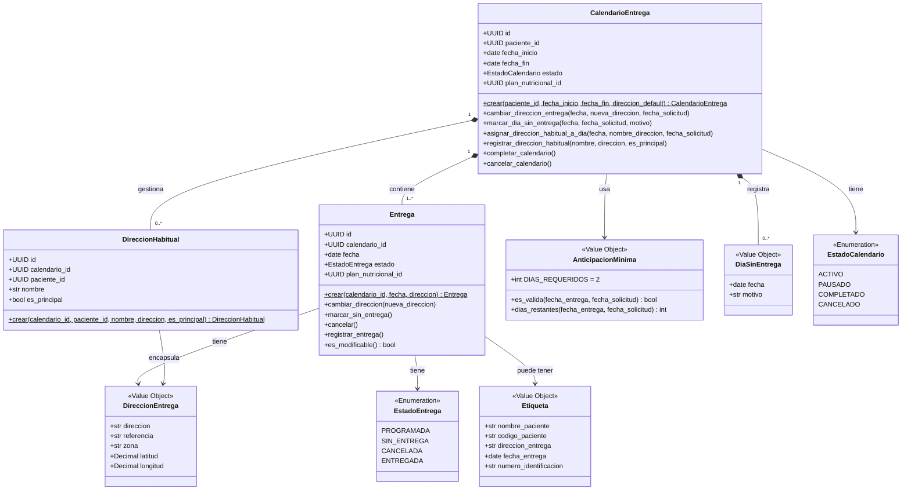

# ms-catering — BC5 Gestión de Catering

**Sistema:** NUR-TRICENTER — Sistema Integral de Gestión Nutricional  
**Responsable:** Luis Humberto Navarro Ribeiro  
**Bounded Context:** BC5 – Gestión de Catering

---

## Descripción

Este microservicio administra el **calendario de entregas del servicio de catering** por paciente.
Permite al paciente configurar qué días recibe su alimentación, en qué dirección y con qué horario,
garantizando que cualquier cambio se realice con la anticipación mínima requerida (2 días).

---

## Bounded Context y Lenguaje Ubicuo

| Término | Definición |
|---|---|
| **Calendario de Entrega** | Planificación de los días en que el paciente recibirá su alimentación durante el período contratado. |
| **Entrega** | Entrega diaria de paquetes de alimentación programada para un paciente en una dirección específica. |
| **Dirección de Entrega** | Ubicación física donde se entregará el paquete en un día concreto. |
| **Dirección Habitual** | Dirección registrada y nombrada (ej. "trabajo", "domicilio") que el paciente puede reutilizar fácilmente. |
| **Cambio de Dirección** | Modificación de la dirección de entrega de un día particular. Requiere anticipación mínima de 2 días. |
| **Día de No Entrega** | Día marcado por el paciente en el que no desea recibir su alimentación. |
| **Anticipación Mínima** | Plazo de 2 días requerido para registrar cualquier cambio en el calendario. |
| **Paquete de Alimentación** | Conjunto de preparaciones envasadas y etiquetadas, listas para entregar al paciente. |
| **Etiqueta** | Identificación del paquete con nombre del paciente, dirección de entrega y número de identificación. |

---

## Historias de Usuario cubiertas

| HU | Requisito | Método del dominio |
|----|-----------|-------------------|
| HU-25 | Consultar calendario de entregas | `GET /calendarios/{id}` → query handler |
| HU-26 | Cambiar dirección de un día específico (≥2 días anticipación) | `CalendarioEntrega.cambiar_direccion_entrega()` |
| HU-27 | Marcar un día como sin entrega | `CalendarioEntrega.marcar_dia_sin_entrega()` |
| HU-28 | Validar y rechazar cambios con menos de 2 días de anticipación | `AnticipacionMinima.es_valida()` + `_verificar_anticipacion()` |
| HU-29 | Visualizar calendario consolidado de todos los pacientes (admin) | `GET /calendarios` → query handler |
| HU-30 | Registrar múltiples direcciones habituales y asignarlas al calendario | `CalendarioEntrega.registrar_direccion_habitual()` + `asignar_direccion_habitual_a_dia()` |

---

## Diagrama de Clases



> **Leyenda:**  
> `*--` composición (el hijo no existe sin el padre) · `-->` uso/asociación  
> `<<Value Object>>` inmutable y sin identidad propia · `$` método de fábrica (classmethod)

---

## Reglas de Negocio e Invariantes

### Invariantes del agregado (siempre se cumplen)

- Todo `CalendarioEntrega` pertenece a exactamente un paciente (`paciente_id`).
- Toda `Entrega` pertenece a un único `CalendarioEntrega`.
- Toda `Entrega` siempre posee una `DireccionEntrega`.
- Toda `Entrega` siempre posee un `EstadoEntrega` válido.

### Reglas de negocio

| Regla | Implementación |
|---|---|
| Cualquier cambio requiere ≥ 2 días de anticipación | `AnticipacionMinima.es_valida()` → `AnticipacionInsuficienteError` |
| Solo se modifican entregas en estado `PROGRAMADA` | `Entrega.es_modificable` → `EntregaNoModificableError` |
| No se puede modificar un calendario inactivo | `_verificar_activo()` → `CalendarioInactivoError` |
| La fecha del cambio debe estar dentro del período | `_verificar_rango()` → `FechaFueraDeRangoError` |
| No puede haber dos direcciones habituales con el mismo nombre | `registrar_direccion_habitual()` → `DireccionHabitualDuplicadaError` |
| Cancelar calendario cancela todas las entregas `PROGRAMADA` | `cancelar_calendario()` itera y cancela en cascada |

---

## Datos de Otros Bounded Contexts (Mockups)

`ms-catering` es **dueño exclusivo** de los datos de BC5 (Calendario, Entrega, DireccionHabitual, DiaSinEntrega).
Los datos que **provienen de otros microservicios** se reciben a través de **interfaces (puertos)** con
implementaciones mock para desarrollo:

| Dato | Origen | Interfaz | Mock actual |
|---|---|---|---|
| `nombre_paciente`, `codigo_paciente`, `numero_identificacion` | **ms-pacientes** (BC1) | `PacienteGateway` | `PacienteGatewayMock` · adaptador real `PacienteGatewayHttp` con contrato Pact |
| `plan_nutricional_id` | **ms-plan-nutricional** (BC3) | referenciado por ID (UUID) | campo opcional en `CalendarioEntrega` |

Cuando los microservicios externos estén disponibles, basta reemplazar los mocks por implementaciones HTTP
sin tocar el dominio.

---

## Excepciones de Dominio

| Excepción | HTTP | Situación |
|---|---|---|
| `AnticipacionInsuficienteError` | 422 | Cambio solicitado con menos de 2 días de anticipación |
| `FechaFueraDeRangoError` | 422 | Fecha fuera del período del calendario |
| `EntregaNoEncontradaError` | 404 | No existe entrega para la fecha indicada |
| `EntregaNoModificableError` | 409 | Entrega ya entregada, cancelada o marcada sin entrega |
| `CalendarioInactivoError` | 409 | Calendario completado o cancelado |
| `DireccionHabitualDuplicadaError` | 409 | Ya existe una dirección habitual con ese nombre |
| `CalendarioNoEncontradoError` | 404 | No existe calendario con el ID indicado |
| `PacienteNoEncontradoError` | 404 | ms-pacientes no reconoce al paciente (adaptador `PacienteGatewayHttp`) |
| `DireccionHabitualNoEncontradaError` | **500** ⚠️ | Sin manejador HTTP todavía — hallazgo documentado en `tests/README.md` §8 |

---

## Arquitectura — DDD por Capas

```
src/catering/
├── domain/                        ← Python puro, sin frameworks
│   ├── model/
│   │   ├── calendario_entrega.py  # Aggregate Root
│   │   ├── entrega.py             # Entidad
│   │   ├── direccion_habitual.py  # Entidad
│   │   ├── value_objects.py       # DireccionEntrega, AnticipacionMinima, DiaSinEntrega, Etiqueta
│   │   └── enums.py               # EstadoCalendario, EstadoEntrega
│   ├── exceptions/                # Excepciones de dominio
│   ├── repositories/              # Interfaz CalendarioEntregaRepository
│   ├── services/                  # ValidadorCambioCalendarioService
│   └── gateways/                  # PacienteGateway (interfaz hacia BC1)
├── application/                   ← Orquestación, sin lógica de negocio
│   ├── commands/                  # Dataclasses de comandos
│   ├── queries/                   # Dataclasses de consultas
│   └── use_cases/                 # Un archivo por caso de uso
├── infrastructure/                ← Implementaciones técnicas
│   ├── persistence/               # ORM models, repo mock (activo), repo impl (listo)
│   ├── gateways/                  # PacienteGatewayMock (activo)
│   └── config/                    # Settings (pydantic-settings)
└── presentation/
    └── api/
        ├── routers/               # Endpoints FastAPI
        └── schemas/               # Schemas Pydantic + mappers
```

---

## Cómo Ejecutar

Todo el stack corre en Docker. Un solo comando levanta la base de datos, el caché, aplica las
migraciones y arranca la API:

```bash
docker compose up -d
# → API en http://localhost:8020
# → Swagger en http://localhost:8020/docs
```

No hace falta nada más: `depends_on` se encarga de que la API espere a que la base de datos y el
caché estén sanos, y a que las migraciones terminen correctamente.

> La API publica un **rango** de puertos (8020-8022) para permitir el escalado. Con una sola
> réplica normalmente queda en el 8020, pero si ese puerto está ocupado Docker toma el siguiente
> libre del rango. Confirma el puerto asignado con `docker compose ps`.

### Imagen publicada

La imagen del servicio está publicada en Docker Hub, por lo que el stack puede levantarse sin
compilar nada:

- https://hub.docker.com/r/betonavarro/ms-catering
- `docker pull betonavarro/ms-catering:0.1.1` (versión vigente; `0.1.0` es la entrega anterior, sin la corrección de `guardar()`)

Para reconstruirla y republicarla tras un cambio de código:

```bash
docker build -t betonavarro/ms-catering:0.1.1 .
docker login
docker push betonavarro/ms-catering:0.1.1
```

> El `Dockerfile` excluye el grupo `test` (`--no-group test`) pero no usa `--no-dev` a propósito: `alembic` está declarado en
> `[dependency-groups] dev`, y el servicio `catering_migrate` lo necesita dentro de la imagen.

### Servicios del stack

| Servicio | Imagen | Puerto (host) | Rol |
|---|---|---|---|
| `catering_db` | postgres:15 | 5433 (`CATERING_DB_PORT`) | Base de datos |
| `catering_cache` | redis:7-alpine | 6381 | Caché (infraestructura; la API aún no lo consume) |
| `catering_migrate` | betonavarro/ms-catering:0.1.1 | — | Aplica `alembic upgrade head` y termina |
| `catering_api` | betonavarro/ms-catering:0.1.1 | 8020-8022 | API FastAPI |

> Los nombres llevan el prefijo `catering_` para poder incluir este archivo (`include:`) en el
> `docker-compose.yml` del grupo sin chocar con los servicios de los demás integrantes. La red
> `nurtricenter_net` es la misma que usa `ms-plan-nutricional`, así que ambos microservicios se
> ven entre sí por nombre de servicio.

### Comandos habituales

```bash
# Estado y salud de los servicios
docker compose ps

# Logs
docker compose logs catering_api
docker compose logs catering_migrate

# Inspeccionar la BD
docker compose exec catering_db psql -U postgres -d db_catering

# Detener (agregar -v para borrar también los datos)
docker compose down
```

### Verificación del stack

```bash
# Los servicios deben reportar (healthy)
docker compose ps

# Red: los contenedores deben aparecer conectados
docker network inspect nurtricenter_net

# DNS interno: resolución por nombre de servicio
docker compose exec catering_api getent hosts catering_db catering_cache
```

Guía completa con evidencia: [`VERIFICACION.md`](VERIFICACION.md).

### Escalado

```bash
docker compose up -d --scale catering_api=3
docker compose ps    # tres réplicas en 8020, 8021 y 8022
```

Detalle del problema y la solución: [`ESCALADO.md`](ESCALADO.md).

### Desarrollo en el host (sin contenedor de API)

Si prefieres iterar sobre el código con recarga automática, levanta solo la infraestructura y
corre la API con `uv`:

```bash
docker compose up -d catering_db catering_cache
uv sync
uv run alembic upgrade head
uv run fastapi dev main.py
# → http://localhost:8000/docs
```

En este modo la app lee `.env` (ver `.env.example`); el default de `settings.py` ya apunta a
`localhost:5433`, que es el puerto que publica `catering_db`.

### Migraciones de base de datos (Alembic)

El esquema es **versionado con Alembic** (equivalente en Python a EF Migrations). Los modelos ORM
(`infrastructure/persistence/orm_models.py`) son la **fuente de la verdad**.

```bash
uv run alembic upgrade head                                  # aplicar migraciones (recrea el esquema en BD vacía)
uv run alembic revision --autogenerate -m "cambio"           # generar migración tras cambiar un modelo ORM
uv run alembic downgrade -1                                  # revertir la última migración
uv run alembic history                                       # ver historial de versiones
```

> **Respaldo manual:** `bd-ms-catering.sql` se conserva como red de seguridad. Para recrear la BD
> sin Alembic contra un Postgres vacío:
> `docker compose exec -T catering_db psql -U postgres -d db_catering < bd-ms-catering.sql`
> No combines ambos métodos sobre la misma BD (las tablas ya existirían y chocarían).

---

## Pruebas y Cobertura

La suite recoge **tres talleres** del diplomado, con la misma arquitectura que
`ms-plan-nutricional`: pruebas unitarias (`tests/unit/`), de integración
(`tests/integration/`) y de contrato con Pact (`tests/contract/`).

```bash
uv sync                                   # instala dev + test (pytest, pytest-asyncio, pytest-cov, httpx, pact-python)

uv run pytest -q                          # toda la suite
uv run pytest tests/unit -q               # unitarias (no necesitan PostgreSQL)

docker compose up -d catering_db          # integración y contrato necesitan la BD...
uv run alembic upgrade head               # ...con el esquema aplicado
uv run pytest tests/integration -v

# COBERTURA DE LA CAPA UNITARIA — el reporte oficial (umbral: 80 %)
uv run pytest tests/unit --cov --cov-report=term-missing     --cov-report=html:htmlcov-unit --cov-report=xml:coverage-unit.xml

# Cobertura de la suite completa (requiere PostgreSQL levantado)
uv run pytest --cov --cov-report=term-missing --cov-report=html:htmlcov
```

| Alcance | Detalle |
|---|---|
| Capa de Dominio | 104 tests — Value Objects, entidades, invariantes y orden de las guardas del agregado, servicio de anticipación |
| Capa de Aplicación | 41 tests — los 6 casos de uso y los 5 query handlers con **mocks** del repositorio (`AsyncMock(spec=...)`) |
| Presentación (sin I/O) | 28 tests — mapper dominio→Pydantic, tabla excepción→HTTP y composición de la app |
| Infraestructura (sin I/O) | 25 tests — gateways de pacientes, repositorio en memoria y mapeo dominio↔ORM |
| Integración (API + BD) | 30 tests — `httpx.AsyncClient` contra la app real y PostgreSQL, **sin mocks** y sin dejar filas |
| Entorno de pruebas | 14 tests que validan las reglas del propio entorno de integración |
| Contratos (Pact) | 5 interacciones consumer en 2 relaciones · 1 verificación de provider · 12 tests del guardián |
| **Cobertura de la capa unitaria** | **82 %** de todo el microservicio, sin base de datos — evidencia en `htmlcov-unit/` y `coverage-unit.xml` |
| Cobertura de la suite completa | 98 %, con PostgreSQL levantado |

**Postman.** `postman/` tiene la colección equivalente (27 peticiones, 45 aserciones
`pm.test`) para ejecutarla contra la API levantada. A diferencia de pytest, **sí escribe** en la base:

```bash
uv run fastapi dev main.py          # en otra terminal
npx newman run postman/ms-catering.postman_collection.json -e postman/ms-catering.postman_environment.json
```

**Entorno de pruebas asistido por IA.** `.claude/` incluye tres subagentes
(`test-writer`, `integration-test-writer`, `pact-writer`) y tres skills con alcances
que no se solapan; los dos guardianes automáticos
(`tests/integration/test_convenciones_del_entorno.py` y
`tests/contract/test_convenciones_contrato.py`) comprueban sus reglas en cada corrida.

> **Corrección aplicada gracias a la suite.** Las pruebas de integración revelaron que
> **toda modificación** del calendario (HU-26, HU-27, HU-30 y la cancelación) respondía 500
> (`MissingGreenlet`): `guardar()` releía el agregado sin sus colecciones. Se corrigió en
> `calendario_repository_impl.py` y `orm_models.py`, y se publica en la imagen
> `betonavarro/ms-catering:0.1.1` (la `0.1.0` es anterior a la corrección). Detalle y demás hallazgos en
> [`tests/README.md`](tests/README.md) §8.

Ver **[tests/README.md](tests/README.md)** para el detalle completo.

---

## Estado Actual

| Componente | Estado |
|---|---|
| Capa de Dominio (AR, Entidades, VOs, Excepciones) | Completo |
| Capa de Aplicación (casos de uso, queries) | Completo |
| API REST (FastAPI, endpoints, schemas) | Completo |
| Persistencia | PostgreSQL 16 vía SQLAlchemy async (activo) |
| Gateway Pacientes | `PacienteGatewayMock` (desarrollo) y `PacienteGatewayHttp` (adaptador real, cubierto por contrato Pact; aún no cableado en los casos de uso) |
| Pruebas unitarias | 198 tests · `pytest` + `unittest.mock` · **82 % de cobertura**, umbral `fail_under = 80` |
| Pruebas de integración | 30 tests sobre `/calendarios` (API + PostgreSQL reales, sin dejar datos) + colección Postman · suite completa 98 % |
| Pruebas de contrato | Pact v3: `app-paciente` → este servicio (verificado) y este servicio → `ms-pacientes` (pact generado) |
| Entorno de pruebas para IA | 3 subagentes + 3 skills + 2 guardianes automáticos (14 + 12 tests) |
| Base de datos | Esquema versionado con **Alembic** (`migrations/`) · `bd-ms-catering.sql` se conserva como respaldo |
